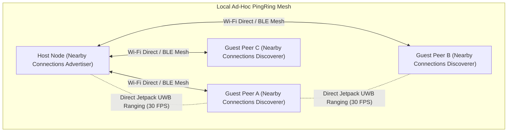

<div align="center">

# 🎯 PingRing

**Serverless, Real-Time P2P Crowd-Finding & Peer Coordination for Android**

[](https://developer.android.com)
[](https://kotlinlang.org)
[](https://developer.android.com/jetpack/compose)
[](https://developers.google.com/nearby/connections/overview)
[](https://developer.android.com/guide/topics/connectivity/uwb)

<p align="center">
  Locate, nudge, chat, and coordinate with friends at crowded events, concerts, or festivals.<br/>
  <b>100% Serverless & Offline &bull; Zero Server Sign-in &bull; Ephemeral & Privacy-First</b>
</p>

---

</div>

## 📌 Table of Contents
- [Overview](#-overview)
- [System Architecture](#-system-architecture)
- [Key Features](#-key-features)
  - [📡 Mesh Networking & Connectivity](#-mesh-networking--connectivity)
  - [👤 User Profiles & Uniqueness](#-user-profiles--uniqueness)
  - [📱 QR & PingRing Code Join](#-qr--pingring-code-join)
  - [👋 Peer Nudges](#-peer-nudges)
  - [🚨 Customizable Peer Beacons](#-customizable-peer-beacons)
  - [💬 Decentralized Chat](#-decentralized-chat)
  - [🧭 Radar & Sensor Fusion Ranging](#-radar--sensor-fusion-ranging)
  - [🎨 Dynamic Theming & App Icon](#-dynamic-theming--app-icon)
  - [🛡 Hardware Adaptation & Device-Aware Permissions](#-hardware-adaptation--device-aware-permissions)
  - [🔒 Privacy & Ephemeral Security](#-privacy--ephemeral-security)
- [Tech Stack](#-tech-stack)
- [Building & Testing](#-building--testing)
  - [🧪 LAN Debug Transport (Emulator ↔ Physical Device Testing)](#-lan-debug-transport-emulator--physical-device-testing)
- [Privacy Model](#-privacy-model)

---

## 📖 Overview

**PingRing** is a native Android crowd-finding application designed for short-lived, high-density events (music festivals, conventions, sports venues, or rallies) where cellular networks are often congested or unavailable.

By leveraging **Google Nearby Connections**, **Bluetooth Low Energy (BLE)**, and **Ultra-wideband (UWB)**, PingRing forms an ad-hoc local peer-to-peer mesh network directly between nearby smartphones. Participants can locate each other on a real-world radar, send haptic nudges, broadcast emergency/intent beacons, and chat in real time without cellular data or an external server.

---

## 🏗 System Architecture

PingRing uses a star/mesh hybrid architecture over Nearby Connections (`P2P_STAR` strategy) with BLE background discovery.



### Protocol Flow
1. **Discovery**: Host advertises the PingRing over BLE Service UUID (`0000fa1b-0000-1000-8000-00805f9b34fb`).
2. **P2P Handshake**: Guests discover the advertiser and establish an encrypted Nearby Connections session.
3. **Data Sync**: Chat messages, nudges, and beacon payloads are brokered and re-broadcasted by the Host to all connected nodes.
4. **Spatial Ranging**: High-precision UWB sessions run concurrently between nodes for sub-metre 3D positioning (distance, azimuth, elevation).

---

## ✨ Key Features

### 📡 Mesh Networking & Connectivity
- **One-Tap Hosting**: Instantly start a local PingRing mesh without server registration.
- **Accept New Members Control**: Host can toggle whether new members can join at creation or mid-event from PingRing Settings. When disabled, incoming connection attempts are rejected, BLE status flags update, and the top bar QR Code button on the Radar screen is hidden until re-enabled.
- **Hardware Toggles**: Enable or disable **Ultra-Wideband (UWB)** and **High-Bandwidth Wi-Fi Direct** on the fly.
- **Bounded Participant Capacity**: Enforces a maximum capacity limit of **8 participants** (1 Host + 7 Guests) per PingRing. Prevents Android radio/socket starvation and guarantees high-performance 30 FPS UWB ranging and instant P2P messaging. The Host automatically rejects connection attempts once full (`8/8 - Full`).
- **Automatic Fallback**: Gracefully falls back from sub-metre UWB ranging to BLE RSSI proximity if UWB is unsupported or unavailable.

### 👤 User Profiles & Uniqueness
- **Custom Usernames**: Easily set your display name when hosting or joining.
- **Persistent Local Profile**: Saves your last entered username locally via DataStore preferences for automatic pre-filling on future sessions.
- **Conflict Prevention**: Enforces name uniqueness within the active PingRing session and alerts you if a chosen username is already taken.

### 📱 QR & PingRing Code Join
- **Camera QR Scanner**: Join instantly by scanning the Host's on-screen QR code using ML Kit vision decoding.
- **6-Character PingRing Code**: Manual fallback entry for quick code typing (`e.g. AB12CD`).
- **Context-Aware Keyboards**: Automatically opens the soft keyboard in **ALL CAPS** for code fields and **Word Capitalization** for usernames.
- **Late-Join QR Access**: When new member acceptance is enabled, a dedicated QR icon button on the Radar screen re-opens the PingRing's QR code at any time so latecomers can scan in mid-event without interrupting the host. If new member acceptance is disabled, the QR button is hidden.

### 👋 Peer Nudges
- **Instant Haptic Alerts**: Send quick targeted nudges (`👋`) to specific peers or broadcast a **Nudge All** to the entire group.
- **Double-Haptic Pulse**: Recipients receive a distinct double-vibration pulse and banner notification without typing text.
- **Always Available**: The Nudge button remains enabled regardless of connection or ranging state, so a nudge can always be attempted.

### 🚨 Customizable Peer Beacons
- **Intent Presets**: Broadcast active beacons with custom intents (*🚨 Emergency*, *✨ Found Something*, *📍 Regroup Here*, *⚠️ Caution*, *⚡ Custom*).
- **Visual & Haptic Personalization**: Choose from 5 color palettes (Crimson, Amber, Emerald, Cyan, Purple) and select custom hardware vibration rhythms from a single-select dropdown (*SOS / Urgent*, *Rapid Alert*, *Steady Pulse*, *Gentle Pulse*, *No Vibration*).
- **Radar Highlighting**: Active beacons illuminate radar rings, peer pins, and wave animations on receiving devices.

### 💬 Decentralized Chat
- **Offline Group Messaging**: Text chat across the Nearby Connections mesh without internet.
- **Sender Labels**: Every chat bubble is labeled with the sender's display name for clear multi-peer conversations.
- **Floating IME Overlay**: The chat window floats directly over the radar canvas when typing, providing clear visibility of messages, and smoothly returns to its docked position when the soft keyboard closes.
- **Host-Preserved History**: The Host retains the full chat transcript for the life of the PingRing and replays it to newly joined or reconnecting peers, so latecomers can catch up on the conversation so far.

### 🧭 Radar & Sensor Fusion Ranging
- **Real-World Orientation**: Sensor fusion integrates rotation-vector, magnetometer, and accelerometer hardware to orient peer vectors into world space.
- **30 FPS Spatial Tracking**: Concurrent non-blocking Jetpack UWB sessions stream sub-metre distance, azimuth, and elevation.
- **Proximity Alerts**: Haptic feedback triggers when a peer enters close range (< 2 meters).
- **Auto-Cleanup**: Stale or disconnected peers expire from the radar canvas after 15 seconds of inactivity.

### 🎨 Dynamic Theming & App Icon
- **Adaptive Icon**: Modern dark navy background layers with a crisp white target radar vector.
- **Material You Dynamic Icons**: Native monochrome app icon support (`ic_launcher_monochrome.xml`) on Android 13+ (API 33+) launchers.
- **System Dark/Light Theme**: Fully respects system light/dark mode and Material 3 dynamic accent palettes.

### 🛡 Hardware Adaptation & Device-Aware Permissions
- **Selective Permission Requests**: Upfront permissions check hardware features (`FEATURE_BLUETOOTH`, `FEATURE_WIFI`, `FEATURE_LOCATION`) on the physical device. Unsupported hardware features skip permission prompts entirely.
- **Graceful UI Disabling**: Features requiring missing hardware (e.g. Camera for QR scanning, UWB radio for precision ranging, Wi-Fi Direct for high bandwidth, or Vibrator motor for haptics) are gracefully disabled with informative status labels instead of stranding users with ungrantable permission dialogs.

### 🔒 Privacy & Ephemeral Security
- **Ephemeral Identifiers**: Every session generates a random peer ID. Leaving or closing a PingRing rotates the ID and wipes local peer state.
- **Self-Filtering**: Local peer IDs are filtered from scan results so you never appear on your own radar.
- **Host Closure**: Host can end the event at any time, broadcasting a BLE closure packet to return all members safely to the home screen.

---

## 🛠 Tech Stack

| Component | Library / Framework |
| :--- | :--- |
| **Language** | Kotlin 2.4+ |
| **UI Framework** | Jetpack Compose + Material 3 |
| **Navigation** | Navigation 3 (`androidx.navigation3`) |
| **P2P Transport** | Google Nearby Connections API (`play-services-nearby`) |
| **Spatial Ranging** | Jetpack UWB (`androidx.core.uwb`) |
| **QR Scanning** | CameraX + Google ML Kit Barcode Scanning |
| **Local Persistence** | Jetpack DataStore Preferences |
| **Asynchrony** | Kotlin Coroutines & StateFlow |

---

## 🚀 Building & Testing

### Prerequisites
- **Android Studio** (Ladybug or newer)
- **JDK 17**
- **Android SDK 37**
- Physical Android device running **Android 10 (API 29)** or newer (UWB features require supported hardware such as Pixel 6 Pro+, Galaxy S21 Ultra+, etc.).

### Build Commands

```bash
# Clone the repository
git clone https://github.com/fkurevija/PingRing.git
cd PingRing

# Run unit tests
./gradlew testDebugUnitTest

# Assemble Debug APK
./gradlew assembleDebug
```

On **Windows (PowerShell)**:
```powershell
.\gradlew.bat testDebugUnitTest assembleDebug
```

The compiled APK will be available at:
`app/build/outputs/apk/debug/app-debug.apk`

### 🧪 LAN Debug Transport (Emulator ↔ Physical Device Testing)

Google Nearby Connections cannot bridge an Android Emulator and a physical device, since the emulator has no real BLE/Wi-Fi Direct radio. For local development, PingRing ships a **debug-only** TCP transport that virtualizes a connection between them over your PC's LAN/loopback, so multi-device P2P flows can be tested without two physical phones:

1. Start the relay server on your development PC:
   ```powershell
   python tools\lan_debug_relay.py
   ```
   Or use the bundled IDE run configurations **"LAN Debug Relay"** (relay only) or **"app + LAN Debug Relay"** (compound: launches the app and relay together).
2. Enable **LAN Debug Transport** in the app's Home screen Settings (gear icon, before hosting/joining) on both the emulator and the physical device.
   - The emulator reaches the relay automatically via `10.0.2.2`.
   - A physical device needs a one-time `adb reverse tcp:8942 tcp:8942` (or a host/IP reachable on your LAN) so it can reach the relay running on your PC.
3. Host on one device and join on the other as usual — messages are relayed over TCP instead of Nearby Connections.
4. Stop the relay with `Ctrl+C` when you are done: the listening socket and every open client connection are closed cleanly, so the port is immediately free for the next run.

The **Developer Options** card that holds the **LAN Debug Transport** toggle only appears in debug builds, and only while the device looks like it is set up for development (ADB over Wi-Fi or USB, a USB cable attached, or an emulator). It stays visible while LAN Debug Transport is on, so the relay can always be switched back off.

This transport is for local testing only and is excluded from release builds; it is not a substitute for testing on real hardware over Nearby Connections before shipping.

#### 📡 Scripted Distance (Testing the Radar Remotely)

Over this transport nothing in the app can measure a distance: the emulator has no UWB radio and no BLE radio, and neither does the relay, so peers arrive on the radar with no distance, no bearing, no arrow and no hot/cold ring. To exercise the ranging features anyway, `tools/mock_radar.py` joins the same event as a third, invisible participant and streams scripted range reports to the other devices, which the app renders through its normal ranging path (only the measurement is fake, never the rendering):

```powershell
# with the relay already running, and the app(s) hosting/joining the event
python tools\mock_radar.py <event-id> --pattern approach
python tools\mock_radar.py <event-id> --pattern orbit --distance 3
python tools\mock_radar.py <event-id> --peer a1b2c3d4 --name "Alice"
```

| Option | What it does |
| --- | --- |
| `--pattern approach` | Walks between `--start` and `--end` metres in place, crossing the sub-2 m proximity haptic twice per cycle (the default) |
| `--pattern orbit` | Holds `--distance` while the bearing sweeps a full circle, to check the compass-corrected arrow |
| `--pattern walk` | Both at once: circling *and* closing in |
| `--pattern static` | A frozen reading, to check a steady state |
| `--peer` | Only drive these peer ids (repeatable). Default: every member of the event |
| `--name` | Display name for the driven peer(s), so two scripted pins are told apart |
| `--period`, `--rate`, `--azimuth`, `--elevation`, `--spread` | Cycle length, reports/second, starting bearing, elevation, and one bearing slice per peer |

The radar reacts exactly as it would to real UWB ranging: the distance readout, the "Direction locked" line, the rings, the arrow, the haptics and the 15 s staleness sweep all follow the script. Run `python tools/test_mock_radar.py` to check the script and the relay path without any device attached.

---

## 🛡 Privacy Model

PingRing is built from the ground up to respect user privacy:

1. **No External Servers**: No account registration, email collection, or remote logging. All data stays local to the ad-hoc mesh.
2. **Ephemeral Identity**: Peer identifiers rotate every session. No persistent tracking cross-event.
3. **Session-Scoped Advertising**: BLE advertising is strictly opt-in and stops when leaving or ending a PingRing.

## Background operation

While a PingRing is active, PingRing runs discovery, advertising, nearby transport, and supported
UWB work from an Android foreground service. The Activity may be placed in the background or its task
may be removed without ending the active PingRing; the persistent notification can reopen the radar.
Android still stops work after a force-stop, process kill, reboot, or revoked runtime permission. A
new session must be started after those cases.

---

<div align="center">
  <sub>Built with ❤️ for privacy-first, off-grid peer coordination.</sub>
</div>
