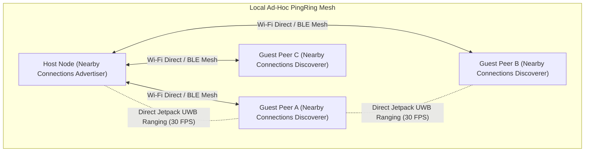

# 🎯 PingRing

**Serverless, Real-Time P2P Crowd-Finding & Peer Coordination for Android**

[](https://developer.android.com)
[](https://kotlinlang.org)
[](https://developer.android.com/jetpack/compose)
[](https://developers.google.com/nearby/connections/overview)
[](https://developer.android.com/guide/topics/connectivity/uwb)

<p align="center">
  Locate, nudge, chat, and coordinate with friends at crowded events, concerts, or festivals.<br/>
  <b>100% Serverless & Offline &bull; Zero Server Sign-in &bull; Ephemeral & Privacy-First</b>
</p>

---

## 📖 Overview

**PingRing** is a native Android app for short-lived, high-density events (festivals, conventions, sports venues, rallies) where cellular networks are congested or unavailable.

Using **Nearby Connections**, **BLE** and **UWB**, it forms an ad-hoc peer-to-peer mesh directly between nearby phones. Participants locate each other on a real-world radar, send haptic nudges, broadcast beacons, and chat in real time — with no cellular data and no external server.

---

## 🏗 System Architecture

Star/mesh hybrid over Nearby Connections (`P2P_STAR`) with BLE background discovery.



### Protocol Flow
1. **Discovery**: Host advertises over BLE Service UUID `0000fa1b-0000-1000-8000-00805f9b34fb`.
2. **P2P Handshake**: Guests discover the advertiser and establish an encrypted Nearby Connections session.
3. **Data Sync**: The Host brokers and re-broadcasts chat, nudges, and beacons to all connected nodes.
4. **Spatial Ranging**: Concurrent UWB sessions run for sub-metre 3D positioning (distance, azimuth, elevation).

---

## ✨ Key Features

### 📡 Mesh & Connectivity
- **One-tap hosting**, no server registration. UWB and high-bandwidth Wi-Fi Direct toggleable on the fly.
- **Admission control**: the Host can stop accepting members at creation or mid-event; connection attempts are then rejected, BLE status flags update, and the Radar's QR button hides until re-enabled.
- **Bounded capacity**: max **8 participants** (1 Host + 7 Guests), enforced by the Host (`8/8 - Full`). Prevents radio/socket starvation, guaranteeing 30 FPS UWB ranging and instant messaging.
- **Automatic fallback** from sub-metre UWB to BLE RSSI proximity when UWB is unsupported or unavailable.

### 👤 Identity, Join & Nudges
- **Custom usernames**, saved locally via DataStore and pre-filled on future sessions. Names are enforced unique within a session, with an alert on collision.
- **Join via QR** (ML Kit, on the Host's on-screen code) or a **6-character PingRing Code** (`e.g. AB12CD`). Code fields force ALL CAPS, usernames use Word Capitalization. The Radar's QR button re-opens the code mid-event for latecomers.
- **Join validation**: a 2.5s timeout verifies the host; on failure the session is cleaned up and the user stays on the join screen to retry.
- **Nudges** (`👋`) target a specific peer or broadcast to all. Recipients get a distinct double-vibration pulse and banner. The button stays enabled regardless of connection or ranging state.

### 🚨 Beacons & Chat
- **Intent presets**: 🚨 Emergency, ✨ Found Something, 📍 Regroup Here, ⚠️ Caution, ⚡ Custom — with 5 colour palettes (Crimson, Amber, Emerald, Cyan, Purple) and 5 vibration rhythms (SOS/Urgent, Rapid Alert, Steady Pulse, Gentle Pulse, No Vibration). Beacons illuminate radar rings, peer pins and wave animations on receivers.
- **Offline group chat** with sender-labelled bubbles. The chat window floats over the radar while typing, then returns to its docked position.
- **Host-preserved history**: the Host keeps the transcript for the life of the PingRing and replays it to peers who join or reconnect.
- **Configurable notifications**: toggle chat push app-wide in App Settings and per-PingRing in Event Settings, with independent **sound** and **vibration** controls. Notifications are suppressed while you are already watching the radar with the screen on and unlocked; the device can still vibrate or sound.

### 🧭 Radar, Theming & Hardware Adaptation
- **30 FPS sensor-fusion tracking**: rotation-vector, magnetometer and accelerometer orient peer vectors into world space while concurrent non-blocking UWB sessions stream sub-metre distance, azimuth and elevation.
- **Proximity haptics** under 2 m; **stale peers expire** from the radar after 15 s.
- **Theming**: Material You dynamic colour, system light/dark, an adaptive navy-and-white radar icon, and a monochrome `ic_launcher_monochrome.xml` for Android 13+ launchers.
- **Device-aware permissions**: unsupported hardware (`FEATURE_BLUETOOTH`, `FEATURE_WIFI`, `FEATURE_LOCATION`, camera, UWB, vibrator) skips its permission prompt, and its UI is disabled with an explanatory label instead of an ungrantable dialog.

---

## 🛠 Tech Stack

| Component | Library / Framework |
| :--- | :--- |
| **Language** | Kotlin 2.4+ |
| **UI / Navigation** | Jetpack Compose + Material 3, Navigation 3 (`androidx.navigation3`) |
| **P2P Transport** | Google Nearby Connections API (`play-services-nearby`) |
| **Spatial Ranging** | Jetpack UWB (`androidx.core.uwb`) |
| **QR Scanning** | CameraX + Google ML Kit Barcode Scanning |
| **Persistence / Asynchrony** | Jetpack DataStore Preferences, Kotlin Coroutines & StateFlow |

---

## 🚀 Building & Testing

**Prerequisites**: Android Studio (Ladybug+), JDK 17, Android SDK 37, and a physical device on **Android 10 (API 29)+**. UWB needs supported hardware (e.g. Pixel 6 Pro+, Galaxy S21 Ultra+).

```bash
git clone https://github.com/fkurevija/PingRing.git
cd PingRing

./gradlew testDebugUnitTest   # unit tests
./gradlew assembleDebug       # debug APK
```

On Windows (PowerShell): `.\gradlew.bat testDebugUnitTest assembleDebug`

The APK lands at `app/build/outputs/apk/debug/app-debug.apk`. Pushing a `v*` tag also builds and publishes it as a GitHub Release via the **Build APK** workflow; every other push rolls a `latest` release forward.

### 🧪 LAN Debug Transport (Emulator ↔ Physical Device)

Nearby Connections cannot bridge an emulator to a physical device, since the emulator has no real BLE/Wi-Fi Direct radio. For local development PingRing ships a **debug-only** TCP transport that virtualizes the connection over your PC's LAN/loopback, so multi-device flows can be tested without two phones.

1. **Start the relay.** Use the bundled run configuration **"app + LAN Debug Relay"**, which runs `adb reverse tcp:8942 tcp:8942` and launches `tools/lan_debug_relay.py` alongside the app. Or run it manually: `python tools\lan_debug_relay.py`.
2. **Enable LAN Debug Transport** in Home → Settings (gear icon, before hosting/joining) on *both* devices. The emulator reaches the relay via `10.0.2.2`; a physical device uses `127.0.0.1`, forwarded by `adb reverse`.
3. **Host on one device, join on the other** as usual — messages relay over TCP instead of Nearby Connections. Stop with `Ctrl+C`, which closes the socket and all clients cleanly so the port is immediately free.

The Developer Options card holding this toggle appears only in debug builds, and only while the device looks set up for development (ADB over USB/Wi-Fi, USB attached, or an emulator). It stays visible while the transport is on so it can always be switched back off.

**Debug only** — excluded from release builds, and not a substitute for testing on real hardware over Nearby Connections.

#### 📡 Scripted Distance (Testing the Radar Remotely)

Over this transport nothing can measure a distance: neither the emulator (no UWB/BLE radio) nor the relay can, so peers arrive with no distance, bearing, arrow or hot/cold ring. To exercise ranging anyway, `tools/mock_radar.py` joins the event as a third, invisible participant and streams scripted range reports, rendered through the normal ranging path — only the measurement is fake, never the rendering:

```powershell
python tools\mock_radar.py <event-id> --pattern approach
python tools\mock_radar.py <event-id> --pattern orbit --distance 3
python tools\mock_radar.py <event-id> --peer a1b2c3d4 --name "Alice"
```

| Option | What it does |
| --- | --- |
| `--pattern approach` | Walks between `--start` and `--end` metres in place, crossing the sub-2 m proximity haptic twice per cycle (default) |
| `--pattern orbit` | Holds `--distance` while the bearing sweeps a full circle, to check the compass-corrected arrow |
| `--pattern walk` | Both at once: circling *and* closing in |
| `--pattern static` | A frozen reading, to check a steady state |
| `--peer` | Only drive these peer ids (repeatable). Default: every member of the event |
| `--name` | Display name for the driven peer(s), so two scripted pins are told apart |
| `--period`, `--rate`, `--azimuth`, `--elevation`, `--spread` | Cycle length, reports/second, starting bearing, elevation, and one bearing slice per peer |

The radar reacts exactly as it would to real UWB: distance readout, "Direction locked" line, rings, arrow, haptics and the 15 s staleness sweep all follow the script. Run `python tools/test_mock_radar.py` to check the script and relay path with no device attached.

---

## 🛡 Privacy Model

1. **No external servers** — no accounts, emails, or remote logging. All data stays on the local mesh.
2. **Ephemeral identity** — a random peer ID per session; leaving or closing rotates it and wipes local peer state, so there is no cross-event tracking. Your own ID is filtered from scan results, so you never appear on your own radar.
3. **Session-scoped advertising** — BLE advertising is opt-in and stops on leave/end. The Host can end an event at any time, broadcasting a BLE closure packet that returns all members to the home screen.

## Background operation

While a PingRing is active, discovery, advertising, nearby transport, and supported UWB work run from an Android foreground service. The Activity may be backgrounded or its task removed without ending the PingRing, and the persistent notification reopens the radar.

Android still stops work after a force-stop, process kill, reboot, or revoked runtime permission; a new session must be started after those.

---

## 📋 TODO: Open Unknowns

Everything here is **unverified on real hardware**. It is written down so the gaps are not mistaken for settled behaviour, and so the next person does not re-derive them. Nothing on this list is known to be broken; it is simply not known to be right.

### Needs multiple physical devices

- **Guest→guest UWB ranging.** Implemented over a relay: one guest offers itself as controller, the host forwards the channel and STS key, the peer named becomes the controlee. Never tested against two real UWB phones. Unverified specifically: whether the radio completes a handshake across a relay-hopped setup, what happens when two guests focus each other simultaneously, and whether one controller scope copes with a guest ranging two different peers at once. Watch `Relaying a UWB ranging offer` / `Accepting a UWB ranging offer` in logcat.
- **UWB at full capacity.** The focus filter reduced the host to one ranging session, which should have removed the old seven-concurrent-sessions risk, but the 8-member case is still unmeasured.
- **The "30 FPS UWB ranging" claim** in Key Features is a design target, not a measurement. Nothing has confirmed it holds at 8 members.
- **BLE reach.** The second scan pass is a reliability improvement, not a range multiplier. At what distance a peer actually disappears, and whether the focus filter changes that, are both unmeasured.
- **RSSI distance accuracy.** `RssiDistanceEstimator` uses `RSSI_AT_ONE_METER = -59` and `PATH_LOSS_EXPONENT = 2.2`. These are reasonable defaults, **not measured values**, and the whole model's accuracy rests on them. They need calibrating against known distances on real devices.

### Known limitations, not yet fixed

- **Coded PHY is unreachable.** It is the only BLE setting that genuinely multiplies range (~4×), and the public SDK does not expose it: `ScanSettings` offers only `PHY_LE_ALL_SUPPORTED` and `AdvertiseSettings.Builder` has no public `setPreferredPhy`. Verified against the API 37 `android.jar`. Getting it needs hidden APIs or reflection, which is a deliberate non-goal here. Consequence: **the practical range ceiling is the BLE scan radius**, and a peer beyond it is invisible to UWB too, because UWB never transports data — chat, beacons and nudges all travel over Nearby Connections (BLE discovery, then Wi-Fi Direct).
- **No mesh extension.** Adding members does not extend coverage. Every link is host↔guest under `P2P_STAR`, so two people who can each reach the host but not each other still cannot see one another. A guest-to-guest link is only ever established *after* both are already in contact with the host, which does not help at the moment it would have mattered.
- **The relayed UWB offer is not end-to-end.** The STS key travels over the encrypted connection to the host, which forwards it verbatim. This matches the existing trust model — a host already brokers and re-broadcasts every message — but guest-to-guest ranging is not private against the host.
- **The LAN debug transport does not test the relay.** Its relay already routes by `targetPeerId`, so a UWB offer arrives with no host hop at all. The debug path cannot reproduce real host-relay behaviour.
- **Advert flags are near their limit.** The flag byte packs `acceptsNewMembers` at bit 6. Current combinations stay under 128 so the masks test correctly, but adding any flag above bit 6 would truncate the byte and corrupt them silently.

### Deliberately out of scope

- **UWB ranging-initiated discovery** — waking a peer by UWB when it is already out of BLE range. This is the architecturally correct fix for the range ceiling and how production UWB apps work, but it needs a discovery path that does not require BLE contact first.
- **Release signing.** Only debug APKs are built and published.
- **The `latest` release rolls on every non-tag push**, including from feature branches. Worth restricting to `master` if releases are meant to track it.

### Carried over from the feature list

Checked against the code, not assumed. These are the ones that are **not** actually done.

- **The Wi-Fi Direct / hotspot settings are accepted but do nothing.** `useWifiDirect` and `useHotspot` are threaded from the `Event` model through `startAdvertising()` into `AdvertisingOptions.Builder`, which sets neither — Nearby Connections picks the transport itself. So both switches in the session and host screens currently toggle a field that has no effect, and the "High Bandwidth Wi-Fi Direct" control is misleading. Either wire the settings to the real Nearby options or remove the controls.
- **Connection method is not chosen intelligently.** UWB is defaulted from `isUwbSupported()` when hosting, and Wi-Fi Direct is hard-coded `true`, but nothing considers API level, hardware, or what the *members* can do beyond the UWB feature flag. Related: there is no dropdown or checkbox list for connectivity — just two boolean switches.
- **Hotspot mode is not implemented at all.** There is no `startLocalHotspot` or SoftAP usage anywhere. The `useHotspot` flag exists on the model and is carried through, but nothing consumes it.

### Worth verifying rather than implementing

- **The scripted radar produces perfectly smooth distance.** `mock_radar.py` moves a peer along exact trajectories, so the radar is never exercised against the noise a real radio produces. Adding a little random jitter to the scripted distance would test the smoothing in `RssiDistanceEstimator` and the staleness sweep properly. This is a test-fidelity gap, not a product bug.
- **The LAN relay's teardown and host-failure handling are implemented but unverified against a real interruption.** The relay closes the event for everyone when the host ends it or fails to return within `HOST_RECONNECT_GRACE_SECONDS`, and `Ctrl+C` tears down every socket. Both read as complete, but only exercised by `test_lan_debug_relay.py` — never against an actual dropped connection or a killed host.

---

## 🗂 Planned Work

Grouped by the area of the app each item belongs to. ✅ marks work that is already done and does not need picking up again.

### Global

- ✅ Define and apply a theme colour throughout the app.
- **Design the logo**, and match the theme colour to it. The colour currently has no logo to be derived from, so this is the blocker for the item below.
- ✅ Theme colour applies app-wide, including to chat bubbles.

### Home — Host / Join PingRing

- **Let the user pick their chat bubble colour**: 4–6 predefined colours plus a "custom" option opening a colour wheel or similar selector for any colour. A beacon toast in chat keeps its own styling and is unaffected; the radar also stays on the global colour rather than adopting the user's.

### Connectivity

- **Make the Wi-Fi Direct / hotspot settings real.** Currently `useWifiDirect` and `useHotspot` are carried through the model into `AdvertisingOptions.Builder`, which sets neither, so both switches are inert. See Coded PHY / no mesh extension above.
- **Consider making sessions discoverable to nearby devices**, gated on a setting, with the host approving or denying individual joins rather than only the current all-or-nothing admission switch.

### Radar

- **Hide End / Leave PingRing while the keyboard is open** for chat, or move it. The chat card already reacts to `isImeVisible`; the buttons do not.
- **Remove Nudge and replace it with a favourite beacon.** Needs a way to mark a favourite in the beacon screen first; no such concept exists yet.
- **Fix radar rendering.** Not yet diagnosed — the specific defect is not recorded anywhere, so this needs a description before it can be picked up.
- ✅ **Track one member at a time.** The focus filter is in, and the UWB session follows the selection.
- **Change the host's default focus to the first member to join**, rather than the nearest. Clients already default to the host. No join-order is recorded on a peer yet, so this needs a join timestamp or an ordering on the friend list.

### Radar — Chat

- ✅ **Push notifications for chat, toggleable per PingRing and app-wide**, with independent sound and vibration controls. (Listed here because it was an open item; it landed in `45f5094` and `1fd7812`.)

### Radar — Beacon

- **Move Emergency off the first position** in the preset list. The presets render in enum order and `SOS` is first, so Emergency is currently the default selection on opening the beacon sheet.
- **Embed an active beacon in the chat** so it stands out from ordinary messages, instead of showing a second toast beneath the beacon banner. At the moment a beacon shows as both a banner above the radar and a card in the remote-alerts list.

### Radar Settings

- No items yet.

### App Settings

- No items yet.

---

<div align="center">
  <sub>Built with ❤️ for privacy-first, off-grid peer coordination.</sub>
</div>
