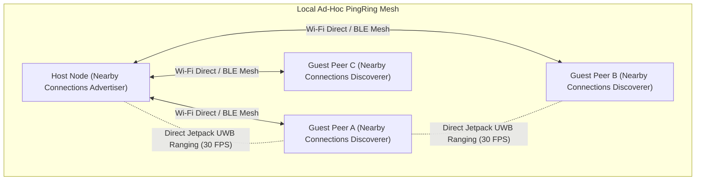

# 🎯 PingRing

**Serverless, Real-Time P2P Crowd-Finding & Peer Coordination for Android**

[](https://developer.android.com)
[](https://kotlinlang.org)
[](https://developer.android.com/jetpack/compose)
[](https://developers.google.com/nearby/connections/overview)
[](https://developer.android.com/guide/topics/connectivity/uwb)

<p align="center">
  Locate, rally, chat, and coordinate with friends at crowded events, concerts, or festivals.<br/>
  <b>100% Serverless & Offline &bull; Zero Server Sign-in &bull; Ephemeral & Privacy-First</b>
</p>

---

## 📖 Overview

**PingRing** is a native Android app for short-lived, high-density events (festivals, conventions, sports venues, rallies) where cellular networks are congested or unavailable.

Using **Nearby Connections**, **BLE** and **UWB**, it forms an ad-hoc peer-to-peer mesh directly between nearby phones. Participants locate each other on a real-world radar, raise haptic beacons, and chat in real time — with no cellular data and no external server.

---

## 🏗 System Architecture

Star/mesh hybrid over Nearby Connections (`P2P_STAR`) with BLE background discovery.



### Protocol Flow
1. **Discovery**: Host advertises over BLE Service UUID `0000fa1b-0000-1000-8000-00805f9b34fb`.
2. **P2P Handshake**: Guests discover the advertiser and establish an encrypted Nearby Connections session.
3. **Data Sync**: The Host brokers and re-broadcasts chat and beacons to all connected nodes.
4. **Spatial Ranging**: Concurrent UWB sessions run for sub-metre 3D positioning (distance, azimuth, elevation).

---

## ✨ Key Features

### 📡 Mesh & Connectivity
- **One-tap hosting**, no server registration. UWB and high-bandwidth Wi-Fi Direct toggleable on the fly.
- **Admission control**: the Host can stop accepting members at creation or mid-event; connection attempts are then rejected, BLE status flags update, and the Radar's QR button hides until re-enabled. Two more switches: **Discoverable** lists the session on nearby phones' join screens, and **Approve Each Join** holds each new member on the radar until the host allows or denies them. Both are off by default and neither affects joining by code.
- **Bounded capacity**: max **8 participants** (1 Host + 7 Guests), enforced by the Host (`8/8 - Full`). Prevents radio/socket starvation, guaranteeing 30 FPS UWB ranging and instant messaging.
- **Automatic fallback** from sub-metre UWB to BLE RSSI proximity when UWB is unsupported or unavailable. The RSSI path is smoothed over a rolling **2-second window** — the mean is taken in dBm and the distance curve applied once to the result, so one reflected or dropped advert cannot move the readout. A time window rather than a per-sample average, because the advertising rate varies by peer and the app only ever sees the reports that arrive.

### 👤 Identity & Join
- **Custom usernames**, saved locally via DataStore and pre-filled on future sessions. Names are enforced unique within a session, with an alert on collision.
- **Join via QR** (ML Kit, on the Host's on-screen code) or a **6-character PingRing Code** (`e.g. AB12CD`). Code fields force ALL CAPS, usernames use Word Capitalization. The Radar's QR button re-opens the code mid-event for latecomers.
- **Join validation**: a 2.5s timeout verifies the host; on failure the session is cleaned up and the user stays on the join screen to retry.

### 🚨 Beacons & Chat
- **Intent presets**: 🚨 Emergency, ✨ Found Something, 📍 Regroup Here, ⚠️ Caution, ⚡ Custom — with 5 colour palettes (Crimson, Amber, Emerald, Cyan, Purple) and 5 vibration rhythms (SOS/Urgent, Rapid Alert, Steady Pulse, Gentle Pulse, No Vibration). Beacons illuminate radar rings, peer pins and wave animations on receivers.
- **Quick Beacon** (`⚡`): set a configuration with **Set as Quick Beacon** in the beacon screen and the radar's Quick Beacon button sends that exact message, colour and rhythm in a single tap — no screen in between. With none set yet, the tap says so in a toast and opens the beacon screen.
- **Offline group chat** with sender-labelled bubbles. The chat window floats over the radar while typing, then returns to its docked position.
- **Beacons live in the chat transcript**: a beacon that is *running* is pinned to the newest end, where a current thing belongs and the eye already is. When it ends it moves back to where it was raised, ordered by timestamp among the messages around it. Nothing about how a beacon looks changes either way — same entry, same styling, just a different place in the conversation. A peer that disconnects mid-beacon has it ended rather than dropped, since it happened.
- **Host-preserved history**: the Host keeps the transcript for the life of the PingRing and replays it to peers who join or reconnect.
- **Configurable notifications**: toggle chat push app-wide in App Settings and per-PingRing in Event Settings, with independent **sound** and **vibration** controls. Notifications are suppressed while you are already watching the radar with the screen on and unlocked; the device can still vibrate or sound.

### 🧭 Radar, Theming & Hardware Adaptation
- **30 FPS sensor-fusion tracking**: rotation-vector, magnetometer and accelerometer orient peer vectors into world space while concurrent non-blocking UWB sessions stream sub-metre distance, azimuth and elevation.
- **Proximity haptics** under 2 m; **stale peers expire** from the radar after 15 s. The RSSI distance is the mean of a rolling 2-second window in dBm, with one window per peer, so a single reflected or dropped advert cannot move the readout and eight members cannot average into each other. It is a window in *time* rather than a count of samples on purpose: a sample-weighted average would smooth differently depending on how often a peer happens to advertise, which the app cannot see.
- **Who is tracked, and who decides**: a **Tracking** dropdown names whoever the radar and the single UWB session are following, and changes it — the per-row buttons can also set it, and tapping the tracked row again returns to the automatic choice. With nothing chosen, a guest follows the **host** and the host follows the **first member it saw** — role-based rather than nearest, because "nearest" changes underneath the user as people walk. Turning on **Track Host** locks every guest to the host and disables the picker for them, visibly rather than by hiding it, so the radar is never pointed at somebody with no way to find out why. The host is never locked: the policy asks *members* to follow it, it does not constrain the host. Everyone still *receives* every message regardless of who is tracked.
- **Directional radar**: a needle points at the tracked member and a lit arc on the ring widens as they approach — a sliver when far, the whole ring within arm's reach (1.5 m). Width is spaced logarithmically, so each doubling of distance gets an equal share of the arc. With no UWB bearing the ring stays plain - signal strength only tints it - rather than inventing a direction.
- **UWB sessions survive a transport drop**: if a member walks out of BLE range while still being tracked, the ranging session is held open for 45 s so walking back is instant instead of renegotiating. Ending or leaving the ring discards every retained address.
- **Theming**: Material You dynamic colour, system light/dark, an adaptive navy-and-white radar icon, and a monochrome `ic_launcher_monochrome.xml` for Android 13+ launchers.
- **Device-aware permissions**: unsupported hardware (`FEATURE_BLUETOOTH`, `FEATURE_WIFI`, `FEATURE_LOCATION`, camera, UWB, vibrator) skips its permission prompt, and its UI is disabled with an explanatory label instead of an ungrantable dialog.

---

## 🛠 Tech Stack

| Component | Library / Framework |
| :--- | :--- |
| **Language** | Kotlin 2.4+ |
| **UI / Navigation** | Jetpack Compose + Material 3, Navigation 3 (`androidx.navigation3`) |
| **P2P Transport** | Google Nearby Connections API (`play-services-nearby`) |
| **Spatial Ranging** | Jetpack UWB (`androidx.core.uwb`) |
| **QR Scanning** | CameraX + Google ML Kit Barcode Scanning |
| **Persistence / Asynchrony** | Jetpack DataStore Preferences, Kotlin Coroutines & StateFlow |

---

## 🚀 Building & Testing

**Prerequisites**: Android Studio (Ladybug+), JDK 17, Android SDK 37, and a physical device on **Android 10 (API 29)+**. UWB needs supported hardware (e.g. Pixel 6 Pro+, Galaxy S21 Ultra+).

```bash
git clone https://github.com/fkurevija/PingRing.git
cd PingRing

./gradlew testDebugUnitTest   # unit tests
./gradlew uiTest              # Compose UI + device tests (needs a booted device)
./gradlew assembleDebug       # debug APK
```

On Windows (PowerShell): `.\gradlew.bat testDebugUnitTest assembleDebug`

The APK lands at `app/build/outputs/apk/debug/app-debug.apk`.

**Releases.** Every successful build on `master` rolls a single `latest` release forward, replacing the previous APK — it is a pointer to the newest build, not a history, and the rolling tag is moved to the commit it contains. Run artifacts keep each build for 90 days. Once a tagged release exists it takes GitHub's "Latest" badge; `latest` deliberately does not claim it.

To keep a build permanently, tag it. A `v*` tag publishes an **immutable** release that is never replaced:

```bash
python tools/tag_release.py            # preview what has landed, changes nothing
python tools/tag_release.py --create   # create and push the tag
```

It suggests the next patch version, refuses to tag a dirty tree, and points the tag at an explicit commit rather than a branch name, so the release cannot move when `master` advances. Pushing the tag triggers the versioned release path in **Build APK**.

**UI tests are opt-in, locally and on CI.** The Compose UI and device suite needs a booted emulator and takes 10–20 minutes mostly waiting, so it is kept out of the everyday commands: `./gradlew check` and `build` run only the JVM unit tests. Run it explicitly when you want it, either locally with `./gradlew uiTest` (or `connectedDebugAndroidTest` directly), or on GitHub from the Actions tab via **Instrumented Tests → Run workflow**. On CI it also runs automatically for `v*` tags, against exactly the APK people install. One trade-off: the coverage page that workflow publishes is then only refreshed on releases, so between tags it describes the last released commit rather than the tip of `master`.

The script also judges whether a release is warranted, counting `feat`/`fix`/`perf` commits as user-facing and ignoring docs, CI and internal work. Every master build writes that assessment to its GitHub Actions run summary, so the suggestion appears where it will be seen — CI advises, it never tags on your behalf.

### 🧪 LAN Debug Transport (Emulator ↔ Physical Device)

Nearby Connections cannot bridge an emulator to a physical device, since the emulator has no real BLE/Wi-Fi Direct radio. For local development PingRing ships a **debug-only** TCP transport that virtualizes the connection over your PC's LAN/loopback, so multi-device flows can be tested without two phones.

1. **Start the relay.** Use the bundled run configuration **"app + LAN Debug Relay"**, which runs `adb reverse tcp:8942 tcp:8942` and launches `tools/lan_debug_relay.py` alongside the app. Or run it manually: `python tools\lan_debug_relay.py`.
2. **Enable LAN Debug Transport** in Home → Settings (gear icon, before hosting/joining) on *both* devices. The emulator reaches the relay via `10.0.2.2`; a physical device uses `127.0.0.1`, forwarded by `adb reverse`.
3. **Host on one device, join on the other** as usual — messages relay over TCP instead of Nearby Connections. Stop with `Ctrl+C`, which closes the socket and all clients cleanly so the port is immediately free.

The Developer Options card holding this toggle appears only in debug builds, and only while the device looks set up for development (ADB over USB/Wi-Fi, USB attached, or an emulator). It stays visible while the transport is on so it can always be switched back off.

**Debug only** — excluded from release builds, and not a substitute for testing on real hardware over Nearby Connections.

#### 📡 Scripted Distance (Testing the Radar Remotely)

Over this transport nothing can measure a distance: neither the emulator (no UWB/BLE radio) nor the relay can, so peers arrive with no distance, bearing, arrow or hot/cold ring. To exercise ranging anyway, `tools/mock_radar.py` joins the event as a third, invisible participant and streams scripted range reports, rendered through the normal ranging path — only the measurement is fake, never the rendering:

```powershell
python tools\mock_radar.py <event-id> --pattern approach
python tools\mock_radar.py <event-id> --pattern orbit --distance 3
python tools\mock_radar.py <event-id> --peer a1b2c3d4 --name "Alice"
```

| Option | What it does |
| --- | --- |
| `--pattern approach` | Walks between `--start` and `--end` metres in place, crossing the sub-2 m proximity haptic twice per cycle (default) |
| `--pattern orbit` | Holds `--distance` while the bearing sweeps a full circle, to check the compass-corrected arrow |
| `--pattern walk` | Both at once: circling *and* closing in |
| `--pattern static` | A frozen reading, to check a steady state |
| `--peer` | Only drive these peer ids (repeatable). Default: every member of the event |
| `--name` | Display name for the driven peer(s), so two scripted pins are told apart |
| `--period`, `--rate`, `--azimuth`, `--elevation`, `--spread` | Cycle length, reports/second, starting bearing, elevation, and one bearing slice per peer |

The radar reacts exactly as it would to real UWB: distance readout, "Direction locked" line, rings, arrow, haptics and the 15 s staleness sweep all follow the script. Run `python tools/test_mock_radar.py` to check the script and relay path with no device attached.

---

## 🛡 Privacy Model

1. **No external servers** — no accounts, emails, or remote logging. All data stays on the local mesh.
2. **Ephemeral identity** — a random peer ID per session; leaving or closing rotates it and wipes local peer state, so there is no cross-event tracking. Your own ID is filtered from scan results, so you never appear on your own radar.
3. **Session-scoped advertising** — BLE advertising is opt-in and stops on leave/end. The Host can end an event at any time, broadcasting a BLE closure packet that returns all members to the home screen.

## Background operation

While a PingRing is active, discovery, advertising, nearby transport, and supported UWB work run from an Android foreground service. The Activity may be backgrounded or its task removed without ending the PingRing, and the persistent notification reopens the radar.

Android still stops work after a force-stop, process kill, reboot, or revoked runtime permission; a new session must be started after those.

---

## 📋 TODO

Two kinds of item: things that are **built but unverified**, and things **not built yet**. Nothing here is known to be broken.

### Unverified — needs real hardware

- **Guest→guest UWB ranging.** Relayed through the host, never tested between two UWB phones. Check: does the handshake complete across a relay hop, what happens when two guests focus each other at once, can one controller scope range two peers. Logcat: `Relaying a UWB ranging offer`, `Accepting a UWB ranging offer`.
- **UWB at 8 members.** The focus filter cut the host to one ranging session, which should have removed the old 7-session risk, but the full case is unmeasured — and the "30 FPS ranging" claim in Key Features is a design target, not a result.
- **BLE reach.** The second scan pass is a reliability gain, not a range multiplier. The ceiling is the radio's own sensitivity, not an app setting: TI's LE 1M reference is -93 dBm, which working back from `RSSI_AT_ONE_METER` is roughly 50 m in free space, 35 m at the `PATH_LOSS_EXPONENT = 2.2` used here, and 14 m at the n=3.0 that crowded indoor venues produce. Treat ~14 m indoors as the expected figure and the exact drop-out as unmeasured. **Verify** by walking two phones apart — clear line-of-sight and through a doorway — until the peer stops appearing.
- **RSSI distance accuracy.** `RSSI_AT_ONE_METER = -59` and `PATH_LOSS_EXPONENT = 2.2` are literature defaults, not measurements on this hardware. -59 dBm at 1 m sits mid-band for a handset (-55 to -65 dBm is the commonly reported range), so it is a reasonable default rather than an arbitrary one — but the accuracy of the readout rests on both constants. One limit no amount of calibration removes: a received advert carries no transmit-power field, so a single fleet-wide constant is necessarily an average across peer models and antennas, and per-peer bias cannot be corrected from the packet. **Verify** by fitting `RSSI = A - 10n·log10(d)` against the UWB distances the app already computes for ranged peers, which needs no extra hardware.
- **LAN relay teardown.** `Ctrl+C` and host-drop handling read as complete, but have only been exercised by `test_lan_debug_relay.py` — never a real dropped connection or killed host.
- **The scripted radar is too clean.** `mock_radar.py` produces exact trajectories, so the radar never meets radio noise. The rolling window now smooths it, but nothing yet produces the *outliers* it is there to reject — a window averages a single bad advert away, which is correct, so the mock no longer proves the filter handles the case it exists for.


### Known limitations

- **Discovery and join approval are unverified on real devices.** Both are built and unit tested, and the approval rules are tested as a pure function, but the part that cannot be tested that way is the one that matters: holding a live Nearby Connections request open across a human decision, and whether it survives a host who takes a minute to answer. Everything here needs two real phones before it is trusted.
- **The host-side request timeout is not enforced.** `expiredJoinRequest` in `NearbyConnectionsManager` defines and tests the 2-minute rule, but nothing calls it, so a request the host walks away from stays pending indefinitely. The guest still times out at 2 min 15 s (`JOIN_WAIT_TIMEOUT_MILLIS` in `MainActivity`), so the failure is the host's side: a queue entry that can never be answered and no longer shows a failure. Wire it to a sweep, or delete the policy and say the host's answer is the only thing that ends a request.
- **The BLE payload is now 20 of the 31 legacy bytes.** A v1 build ignores a v2 advert instead of misreading it, so mixed-version rings half-work: a v1 guest joins by code and appears as a member, but cannot browse. The 11 spare bytes are named and asserted; going past them means BLE 5 extended advertising and losing devices that only do legacy.

- **The range ceiling is the BLE scan radius.** Coded PHY is the only BLE setting that genuinely multiplies range, and the public SDK does not expose it — `ScanSettings` has only `PHY_LE_ALL_SUPPORTED` and `AdvertiseSettings.Builder` has no `setPreferredPhy` (verified against the API 37 `android.jar`). Getting it needs hidden APIs, a deliberate non-goal here. The commonly quoted "~4×" is a free-space figure: 4× range is 12 dB of extra link budget, and at the `PATH_LOSS_EXPONENT = 2.2` used here the same 12 dB is 3.5×. Silicon Labs quotes 4–6 dB of real-world sensitivity gain instead, which is 1.5–1.8× at that exponent. Either way it would not help PingRing: the gain applies to established connections via `HCI_LE_SetPhy`, and PingRing advertises non-connectable and never forms a link. UWB does not widen this: it never transports data, so a peer past the BLE radius is invisible to it too.
- **No mesh extension.** Adding members adds density, not reach. Every link is host↔guest under `P2P_STAR`, and a guest-to-guest link forms only *after* both already reach the host.
- **The host's tracked-member choice is not broadcast.** A guest resolves the *rule* independently — it defaults to the host — but it cannot learn which member the host itself picked. The advertisement is the only thing a device broadcasts before it has a transport, and all 13 bytes of it are accounted for: 4 for the event hash, 1 for flags, 8 for the peer id. Adding a field is a wire-format change, not a UI one. It only matters with **Track Host** off, where a guest may pick freely anyway.
- **Relayed UWB offers are not end-to-end.** The STS key travels via the host. Same trust model as relayed chat — a host already brokers everything — but guest-to-guest ranging is not private against the host.
- **Wi-Fi Direct / hotspot switches are inert.** `useWifiDirect` and `useHotspot` are carried into `AdvertisingOptions.Builder`, which sets neither, so both UI controls toggle a field with no effect. Hotspot mode itself is never implemented. This is the one item here that can actively mislead a user rather than merely be unfinished.
- **Advert flags are one bit from trouble.** `acceptsNewMembers` sits at bit 6; current combinations stay under 128, but any flag above bit 6 would truncate the byte silently.
- **A retained member cannot be confirmed gone.** Holding a UWB session open across a transport drop buys an instant reconnect, but the far end stopping to range is indistinguishable from it having left the ring or from the host having ended it — all three produce the same silence. The app therefore reports a silent session as *unreachable* and says so, rather than claiming the member left. A real fix needs both sides to agree on a farewell message, which needs the transport that has just dropped.
- **The `latest` release rolls on every non-tag push**, feature branches included. Restrict to `master` if releases should track it. Only tag pushes create a permanent version, so a build worth keeping is lost after 90 days unless it is tagged.

### Out of scope

- **UWB ranging-initiated discovery** — waking a peer already out of BLE range, so UWB rather than BLE sets the reach ceiling. **Not possible on Android.** `androidx.core.uwb` exposes no discovery API at all: `UwbManager` has only the three session scopes plus availability, and `UwbControllerSessionScope` only accepts a `UwbAddress` you already hold. The spec's discovery exchange happens *inside* an established session and the platform does not expose it, so there is no way to learn a peer's 2-byte address before hearing from them. Reaching beyond BLE needs a different radio, not a different UWB API.
- **Retained members cannot be confirmed gone.** While a member is held on UWB after a transport drop, the app cannot tell "walked out of range" from "left the ring" or "the host ended the ring" — a stopped UWB session is the only signal, and all three look the same. The retention window and the unreachable report are the mitigation, not a fix; see the entry under *Known limitations*.
- **Release signing.** Only debug APKs are built and published.

### Planned work

Grouped by area. Nothing here is known to be broken: these are things not built, or built and unverified. Resolved items are struck through and kept only where the reasoning is worth not re-deriving.

**Global**
- **Define the brand colour and match it to the logo.** The theme colour is applied throughout today — including chat bubbles, until a user picks their own — but there is no logo to derive it from, so the identity is undefined.
- **Per-user chat bubble colour**: 4 presets plus a "custom" option opening a colour wheel. Today every bubble uses the global theme colour. Beacon entries keep their own styling and the radar stays global — neither is affected by the choice.
- **Replace the v1 advertisement compatibility path with v2 only.** v1 has never shipped outside test devices, so reading it is code that exists to serve nobody. Drop it unless v1 and v2 are deliberately kept for different hardware ages or API levels — in which case say so, because the current shape implies a compatibility promise the project has not made.
- **Accessibility audit.** Decorative icons correctly pass `contentDescription = null`, but nothing has checked the app against an accessibility standard, and the radar is drawn on a `Canvas` that no screen reader can describe at all.
- **Multi-language support.** Every string is a hard-coded literal.
- **Help and documentation.** An open question rather than a decision: an offline in-app knowledge base versus spreading help through the app. Needs Iloha's input before it is worth building.
- **Security review.** Untested and unaudited: whether connections can be eavesdropped, and whether the BLE advert or the Nearby handshake can be leveraged against a device. The app's privacy claims rest on this being answered.
- **Development request portal.** Consider a form or bot that opens — and de-duplicates against existing — GitHub issues, so requests are tracked rather than living in chat.

**Home — Host / Join**
- ✅ Host and join entry points, with each option explained.
- ✅ Admission control: accept/deny, capacity, Discoverable, Approve Each Join. See *Known limitations* for what is unverified.

**Connectivity**
- **Implement Wi-Fi Direct, or a host hotspot with clients joining it.** Both switches are currently inert, and multi-client support is the open question: Wi-Fi Direct is P2P by nature, and a hotspot is the more likely shape for eight members. See *Known limitations*.
- **Choose the connection method by capability.** UWB defaults from `isUwbSupported()` and Wi-Fi Direct is hard-coded `true`; nothing considers API level or what members support. No dropdown or checkbox list exists, only two switches.
- ~~**Optionally make sessions discoverable** to nearby devices behind a setting, with the host approving individual joins rather than the current all-or-nothing switch.~~ Resolved: a **Discoverable** switch advertises the session and the join screen lists what is nearby; **Approve Each Join** holds new members for the host to allow or turn away. Both default to off, and neither changes code joining. Advertising the event code is what made this possible at all, so the BLE payload is now versioned (v2, 20 bytes); see *Known limitations* for the v1 question and for what is unverified.
- **Tune antenna use across BLE, UWB and Wi-Fi.** Three radios competing on one battery, with BLE scanning continuously and UWB ranging held open for 45 s after a drop. Nothing has measured what that costs.

**Radar**
- ~~**Hide End / Leave PingRing while the keyboard is open.**~~ Resolved: the button moved to the **PingRing Settings** screen, and the radar keeps the navigation bar back arrow as the exit route.
- ~~**Replace Nudge with a favourite beacon.**~~ Resolved: Nudge is gone everywhere, wire format included; the beacon screen sets a configuration as the **Quick Beacon** (**Set as Quick Beacon**, kept in DataStore) and the radar's **Quick Beacon** button sends it in one tap — toasting and opening the beacon screen when none is set.
- ~~**Fix radar rendering.**~~ Resolved: the lit arc was inscribed in an oval the size of the *canvas* instead of the ring's own square, which put the arc's centre nearly a full radius below-right of the ring's, so the highlight rendered as a stray arc beside the ring, clipped where it left the canvas. The ring and its arc now come from one `RadarDirectionPolicy.ringGeometry`, and unit tests pin the arc concentric with the ring on square and non-square canvases.
- ~~**Default the host's focus to the first member to join** rather than the nearest.~~ Resolved: `FocusPolicy.resolveFocus` falls back to the first member in discovery order, and a guest to the host, so the default is stable instead of moving with whoever is closest. **Caveat:** there is still no join *timestamp* on a peer, so "first to join" is standing in for "first to be discovered" — a member who joins late and is nearest could be picked. Adding a join time to `RadarPeerUpdate` would close that.
- ✅ Track one member at a time; the UWB session follows the selection. Defaults are role-based: a guest follows the host, the host follows the first member it saw.
- **The two settings screens should not both own the event switches.** The host setup screen duplicates five of them and reaches the other two only through a link; one screen should own them all.

**Radar — Chat**
- ✅ Push notifications for chat, per-PingRing and app-wide, with independent sound and vibration.
- ✅ **Embed an active beacon in the chat** so it stands out from ordinary messages. Every active beacon appears once, as a full-width colour-banded chat entry, the sender's own included: a beacon is broadcast to the ring, so every member's chat reads the same. The banner above the radar is kept for the local beacon, because that is where its Stop control lives.
- ✅ ~~**An ended beacon keeps its place in the transcript.**~~ Resolved: `ChatTimelinePolicy` orders messages and ended beacons together by timestamp, so a beacon settles back where it was raised; a running beacon stays pinned to the near end. This also fixes a peer disconnecting mid-beacon silently deleting it from the record.

**Radar — Beacon**
- **Move Emergency off the first preset slot.** Presets render in enum order and `SOS` is first, so Emergency is the default selection when the sheet opens — and it is a one-line move in `BeaconPreset`.

**Radar Settings · App Settings**
- No items yet.

---

<div align="center">
  <sub>Built with ❤️ for privacy-first, off-grid peer coordination.</sub>
</div>
