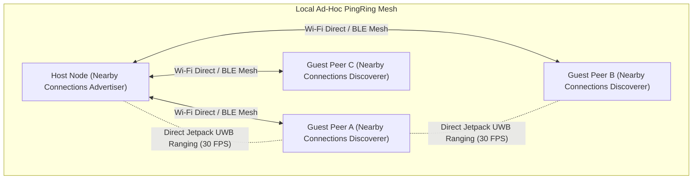

# 🏗 Architecture & Privacy

[← Back to README](../README.md) · [User Guide](user-guide.md) · [Features](features.md) · [Building & Testing](building.md) · [Roadmap](roadmap.md)

## System Architecture

Star/mesh hybrid over Nearby Connections (`P2P_STAR`) with BLE background discovery.

### Protocol Flow
1. **Discovery**: Host advertises over BLE Service UUID `0000fa1b-0000-1000-8000-00805f9b34fb`.
2. **P2P Handshake**: Guests discover the advertiser and establish an encrypted Nearby Connections session.
3. **Data Sync**: The Host brokers and re-broadcasts chat and beacons to all connected nodes.
4. **Spatial Ranging**: Concurrent UWB sessions run for sub-metre 3D positioning (distance, azimuth, elevation).

---

## Privacy Model

1. **No external servers** — no accounts, emails, or remote logging. All data stays on the local mesh.
2. **Ephemeral identity** — a random peer ID per session; leaving or closing rotates it and wipes local peer state, so there is no cross-event tracking. Your own ID is filtered from scan results, so you never appear on your own radar.
3. **Session-scoped advertising** — BLE advertising is opt-in and stops on leave/end. The Host can end an event at any time, broadcasting a BLE closure packet that returns all members to the home screen.

## Background operation

While a PingRing is active, discovery, advertising, nearby transport, and supported UWB work run from an Android foreground service. The Activity may be backgrounded or its task removed without ending the PingRing, and the persistent notification reopens the radar.

Android still stops work after a force-stop, process kill, reboot, or revoked runtime permission; a new session must be started after those.

---

[← Back to README](../README.md)
