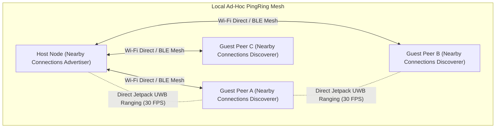

# 🏗 Architecture & Offline Operation

[← Back to README](../README.md) · [User Guide](user-guide.md) · [Features](features.md) · [Building & Testing](building.md) · [Roadmap](roadmap.md)

## System Architecture

Star/mesh hybrid over Nearby Connections (`P2P_STAR`) with BLE background discovery.

### Protocol Flow
1. **Discovery**: Host advertises over BLE Service UUID `0000fa1b-0000-1000-8000-00805f9b34fb`.
2. **P2P Handshake**: Guests discover the advertiser and establish an encrypted Nearby Connections session.
3. **Data Sync**: The Host brokers and re-broadcasts chat and beacons to all connected nodes.
4. **Spatial Ranging**: Concurrent UWB sessions run for sub-metre 3D positioning (distance, azimuth, elevation).

---

## Offline operation

**Offline is the product, not a limitation.** The reason this app exists is the moment a venue's data network stops working — a sold-out stage where the bars go quiet, a rally field with no bars at all. Everything below is in service of that moment.

1. **No external infrastructure to fail.** There is no server, no account, no remote logging, and no dependency on anyone's uptime. Nothing to be down, because nothing is there. Discovery, transport, chat, ranging and beacons are all local.
2. **Nothing to configure.** No network to join, no SSID, no password, no login. Phones find each other directly over BLE and Nearby Connections.
3. **It works before it works.** A phone with no SIM, in aeroplane mode with Wi-Fi and Bluetooth on, runs a full PingRing.
4. **It degrades rather than dies.** Ranging runs down a ranked chain — UWB, then Wi-Fi RTT, then GNSS, then BLE signal strength — so losing the most precise method costs accuracy, not the feature. `RangingSourcePolicy` holds the ordering and reports which rung is running and why a better one is unavailable. **UWB and RSSI are the only rungs live today.** Wi-Fi RTT has its policy, its capability probe and its correlation layer (`WifiRttCorrelation`, which decides which member a result belongs to and discards anything it cannot attribute) but no ranging session; GNSS is policy only, and still has no way to share a fix between phones. See the roadmap.

### Ephemeral identity

A random peer ID per session, rotated on leave — so there is nothing that carries across events, and no account to correlate anything with. Your own ID is filtered from scan results, so you never appear on your own radar. BLE advertising is opt-in and stops on leave/end; ending an event broadcasts a closure packet that returns every member to the home screen.

### Location permission

Location permission is required because the radios that make this work are proximity sensors that Android gates behind it — not because anything is uploaded anywhere.

- **Turning location off breaks ranging.** Wi-Fi RTT returns nothing when location services are off device-wide, even with the permission granted, and UWB has the same dependency. PingRing names which one is blocking rather than silently showing a stale distance.
- **Location is used for ranging between nearby devices, and nothing else.** No coordinates are transmitted, because there is nowhere to transmit them to.

## Background operation

While a PingRing is active, discovery, advertising, nearby transport, and supported UWB work run from an Android foreground service. The Activity may be backgrounded or its task removed without ending the PingRing, and the persistent notification reopens the radar.

Android still stops work after a force-stop, process kill, reboot, or revoked runtime permission; a new session must be started after those.

---

[← Back to README](../README.md)
