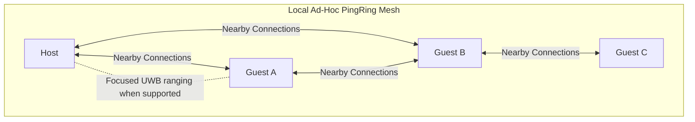

# 🏗 Architecture & Offline Operation

[← Back to README](../README.md) · [User Guide](user-guide.md) · [Features](features.md) · [Building & Testing](building.md) · [Roadmap](roadmap.md)

## System Architecture

Bounded peer relay mesh over Nearby Connections (`P2P_CLUSTER`) with BLE discovery and signed member presence.

### Protocol Flow
1. **Discovery and admission**: Members advertise and discover with `P2P_CLUSTER`. Hosts include a role hint in their Nearby endpoint name so a new guest can find the host without receiving a separate BLE advertisement. This hint is not authentication: QR/NFC invite-secret proof or host approval still gates admission. A new member must join the host directly; only the host admits members. Both phones need the updated build for the Nearby-only host hint; older hosts still rely on the BLE discovery hint.
2. **Mesh link proof**: Already-admitted members authenticate each new link with a fresh nonce signed by their registered per-event key.
3. **Data routing**: Signed-origin envelopes carry radar presence, chat, per-recipient chat receipts, beacons, UWB coordination, and host controls. Chat messages optionally include a send-time recipient snapshot for compatibility with older peers. A recipient sends delivery acknowledgment after accepting a message; read acknowledgment is sent only while that message is visible in the foreground chat and the local **Read Receipts** preference is enabled. Receipt updates are accepted only for a matching local outgoing message and snapshotted recipient, and status advances monotonically. Relays suppress duplicate IDs, forward at most seven hops, and hold failed-route traffic in a bounded in-memory queue until a route returns or the Ring ends.
4. **Presence versus proximity**: A five-second signed heartbeat can show a member as present through the mesh and carries their current username. Username edits broadcast immediately and subsequent heartbeats repeat the latest name. It carries no RSSI, range, or bearing; those remain local BLE/UWB measurements.
5. **Spatial ranging**: Fresh UWB supplies distance and bearing. Compatible Wi-Fi Aware phones can range the focused member directly with public Wi-Fi RTT APIs using an origin-signed, short-lived Aware address binding; no venue access point is needed. RTT is distance-only. GPS sharing is unconditional and supplies a labelled coordinate-derived estimate with uncertainty. An independent, confidence-gated GPS direction supplement can fill an unavailable bearing without replacing UWB/RTT/RSSI distances or fresh measured bearings. BLE RSSI remains the local signal-strength fallback.

---

## Localization

User-facing interface, accessibility, and notification-channel text lives in Android string resources. English in `values/strings.xml` is the fallback; language-qualified resource sets provide Croatian, Spanish, French, Canadian French, German, and Russian. `locales_config.xml` exposes those choices to Android's per-app language settings on Android 13 and newer. Older supported versions use the device locale. Protocol values and participant-authored chat/beacon text are not translated.

---

## Transport security

V5 BLE presence is gated by a registered-key nonce response on the member's Nearby link. The response must arrive within fifteen seconds and is valid for ten seconds on a monotonic clock; advertisements cannot extend it. Proof is renewed on demand, and missing or expired proof prevents BLE sequence/RSSI/radar updates. Mesh availability and UWB measurements remain separate from this gate. This proves live key control, not physical proximity.

Nearby encrypts established payload transport. The **Verify Nearby connections** App Settings switch (off by default) controls whether both users must compare Nearby's authentication digits before PingRing accepts the join control channel. When off, the comparison is bypassed; ordinary traffic remains blocked until QR-secret verification or host approval through the same Allow/Deny card used by LAN debug. Encryption alone does not authenticate the intended person, so bypassing digit comparison leaves initial discovery vulnerable to impersonation or interception. The QR carries a 256-bit invite secret; BLE advertises only the six-character public event locator and a discovery hint before joining. In-session V5 advertisements are signed with per-event device keys registered over the admitted Nearby link. Devices without extended-advertising support do not use RSSI-based presence. See the [Security Review](security-review.md) for accepted trust boundaries, replay limits and the plaintext debug-relay boundary.

On NFC-capable hosts with Host Card Emulation, the foreground invitation screen exposes the same `pingring://join` URI over an ISO-DEP APDU service while the screen is open. The guest reads it with NFC reader mode; both paths use `PingRingCodeParser` and the existing invite-secret admission proof. The 256-bit secret is held in memory only while the host invitation is shown and is not logged or persisted by the NFC service. NFC does not add channel encryption or distance-bounding: treat an NFC tap invitation like the QR bearer secret and share it only with intended guests. Devices without NFC/HCE, or with NFC switched off, use the existing QR or typed-code path.

---

## Offline operation

**Offline is the product, not a limitation.** The reason this app exists is the moment a venue's data network stops working — a sold-out stage where the bars go quiet, a rally field with no bars at all. Everything below is in service of that moment.

1. **No external infrastructure to fail.** There is no server, no account, no remote logging, and no dependency on anyone's uptime. Nothing to be down, because nothing is there. Discovery, transport, chat, ranging and beacons are all local.
2. **Nothing to configure.** No network to join, no SSID, no password, no login. Phones find each other directly over BLE and Nearby Connections.
3. **It works before it works.** A phone with no SIM, in aeroplane mode with Wi-Fi and Bluetooth on, runs a full PingRing.
4. **It degrades rather than dies.** Fresh UWB takes precedence over compatible phone-to-phone RTT, then host-enabled GPS estimates, then signed local BLE RSSI. RTT cannot supply bearing; GPS is a coarse estimate. Mesh presence can show a member without claiming range. On unsupported controllers, RSSI proximity fails closed rather than accepting the spoofable V4 packet. Radio compatibility and accuracy still require [hardware validation](roadmap.md#unverified).

### Ephemeral identity

A random peer ID per session, rotated on leave — so there is nothing that carries across events, and no account to correlate anything with. Your own ID is filtered from scan results, so you never appear on your own radar. BLE advertising is opt-in and stops on leave/end; event closure is sent over the authenticated Nearby connection rather than as a trusted BLE control packet.

### Location permission

Location permission is required because the radios that make this work are proximity sensors that Android gates behind it — not because anything is uploaded anywhere.

- **Turning location off can break ranging.** UWB, Wi-Fi RTT and GPS depend on the applicable location permissions and services. Unavailable sources do not fabricate readings.
- **Coordinate sharing is unconditional per Ring.** It was host-opt-in and defaulted off, which meant a guest could not see whether it was on: two phones in the same ring could hold different beliefs about whether coordinates were flowing, and a partially-publishing ring showed a distance estimate that was quietly missing sources. Valid GPS fixes are rounded to an approximately 10 m grid and broadcast at ten-second intervals in signed member messages. Device accuracy plus quantization uncertainty is shown; distance fixes expire after thirty seconds. Direction supplementation requires both fixes no older than ten seconds and a reliable screen-relative compass heading, corrected for magnetic declination. The position-error radii and a 10° heading allowance must fit within a 30° uncertainty limit at no more than 100 m separation. Estimates are labelled and never stored as UWB observations. Coordinates are readable by admitted members/relays, kept in memory, and not replayed from partition queues. RTT remains distance-only.

- **The BLE advertisement no longer carries policy flags.** It carried a discoverable bit, so a PingRing could be found and joined by a phone nobody had told about it, and a track-host bit, so one host's choice propagated into every guest's radar. Both described host policy that no longer exists; the remaining bits keep their wire values rather than being renumbered, so the surviving flags keep their meaning.

- **The authenticated event-control payload lost its track-host field.** A build before this change and a build after it cannot join the same PingRing. Both members of the test group run the current build, and the alternative — carrying a field nobody reads — is worse.

## Background operation

While a PingRing is active, discovery, advertising, nearby transport, and supported UWB work run from an Android foreground service. The Activity may be backgrounded or its task removed without ending the PingRing, and the persistent notification reopens the radar.

Android still stops work after a force-stop, process kill, reboot, or revoked runtime permission; a new session must be started after those.

---

[← Back to README](../README.md)
