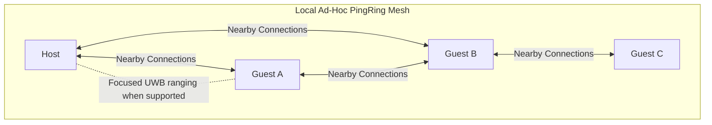

# 🏗 Architecture & Offline Operation

[← Back to README](../README.md) · [User Guide](user-guide.md) · [Features](features.md) · [Building & Testing](building.md) · [Roadmap](roadmap.md)

## System Architecture

Bounded peer relay mesh over Nearby Connections (`P2P_CLUSTER`) with BLE discovery and signed member presence.

### Protocol Flow
1. **Discovery and admission**: Members advertise and discover with `P2P_CLUSTER`. A new member must join the host directly; only the host admits members.
2. **Mesh link proof**: Already-admitted members authenticate each new link with a fresh nonce signed by their registered per-event key, without another SAS prompt.
3. **Data routing**: Signed-origin envelopes carry radar presence, chat, beacons, UWB coordination, and host controls. Relays suppress duplicate IDs, forward at most seven hops, and hold failed-route traffic in a bounded in-memory queue until a route returns or the Ring ends.
4. **Presence versus proximity**: A five-second signed heartbeat can show a member as present through the mesh. It carries no RSSI, range, or bearing; those remain local BLE/UWB measurements.
5. **Spatial ranging**: A focused UWB session provides distance and bearing when supported; otherwise the app estimates distance from locally received signed BLE RSSI. Wi-Fi RTT and GNSS are not connected to live ranging in this build.

---

## Localization

User-facing interface, accessibility, and notification-channel text lives in Android string resources. English in `values/strings.xml` is the fallback; language-qualified resource sets provide Croatian, Spanish, French, Canadian French, German, and Russian. `locales_config.xml` exposes those choices to Android's per-app language settings on Android 13 and newer. Older supported versions use the device locale. Protocol values and participant-authored chat/beacon text are not translated.

---

## Transport security

Nearby encrypts established payload transport. PingRing requires both users to compare and confirm Nearby's shared authentication digits before accepting a connection. The QR carries a 256-bit invite secret; BLE advertises only the six-character public event locator and a discoverability hint before joining. In-session V5 advertisements are signed with per-event device keys registered over the confirmed Nearby link. Devices without extended-advertising support do not use RSSI-based presence. See the [Security Review](security-review.md) for replay limits and the plaintext debug-relay boundary.

---

## Offline operation

**Offline is the product, not a limitation.** The reason this app exists is the moment a venue's data network stops working — a sold-out stage where the bars go quiet, a rally field with no bars at all. Everything below is in service of that moment.

1. **No external infrastructure to fail.** There is no server, no account, no remote logging, and no dependency on anyone's uptime. Nothing to be down, because nothing is there. Discovery, transport, chat, ranging and beacons are all local.
2. **Nothing to configure.** No network to join, no SSID, no password, no login. Phones find each other directly over BLE and Nearby Connections.
3. **It works before it works.** A phone with no SIM, in aeroplane mode with Wi-Fi and Bluetooth on, runs a full PingRing.
4. **It degrades rather than dies.** UWB provides distance and bearing when supported; signed BLE RSSI is the local proximity fallback only when the controller supports V5 extended advertising. Mesh presence can still show a connected member without claiming range. On unsupported controllers, RSSI-based proximity is unavailable rather than accepted from the spoofable V4 packet. Wi-Fi RTT has policy and capability helpers but no ranging session, while GNSS is policy-only and has no peer-fix sharing path. See [Known limitations](roadmap.md#known-limitations).

### Ephemeral identity

A random peer ID per session, rotated on leave — so there is nothing that carries across events, and no account to correlate anything with. Your own ID is filtered from scan results, so you never appear on your own radar. BLE advertising is opt-in and stops on leave/end; event closure is sent over the authenticated Nearby connection rather than as a trusted BLE control packet.

### Location permission

Location permission is required because the radios that make this work are proximity sensors that Android gates behind it — not because anything is uploaded anywhere.

- **Turning location off can break ranging.** UWB depends on location access. Wi-Fi RTT also requires location services, but is not an active ranging source in this build.
- **Location is used for ranging between nearby devices, and nothing else.** No coordinates are transmitted, because there is nowhere to transmit them to.

## Background operation

While a PingRing is active, discovery, advertising, nearby transport, and supported UWB work run from an Android foreground service. The Activity may be backgrounded or its task removed without ending the PingRing, and the persistent notification reopens the radar.

Android still stops work after a force-stop, process kill, reboot, or revoked runtime permission; a new session must be started after those.

---

[← Back to README](../README.md)
